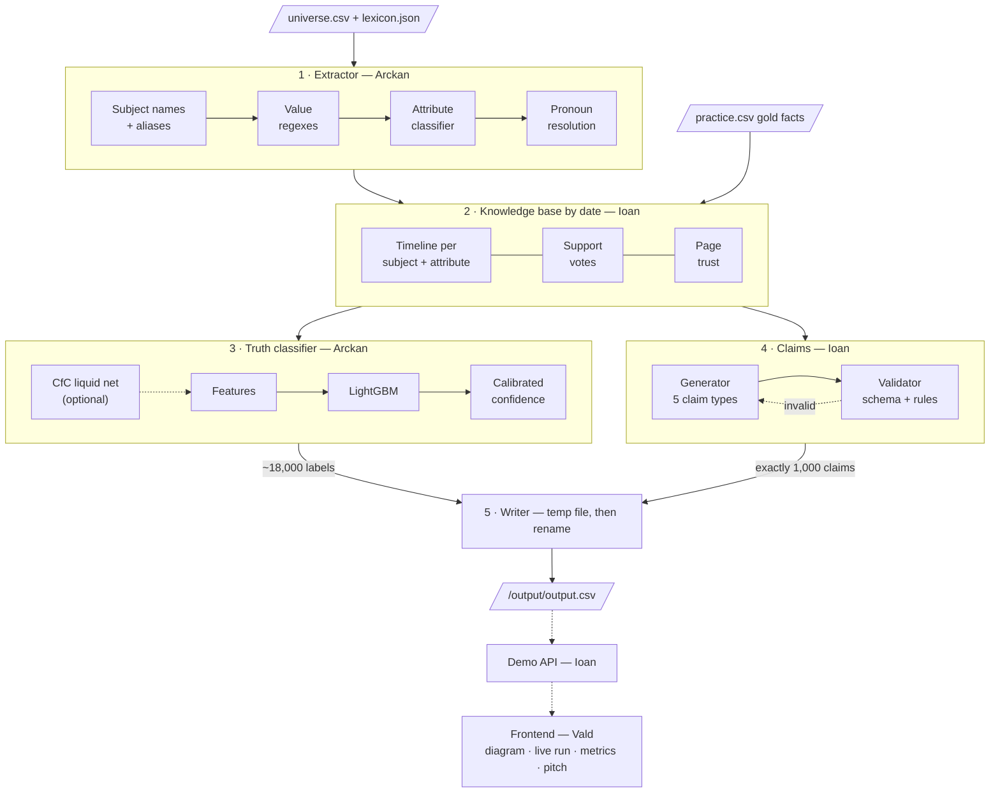
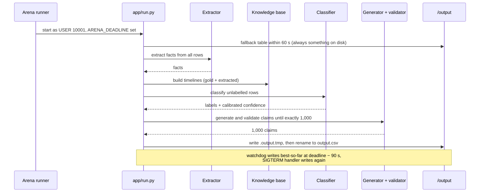
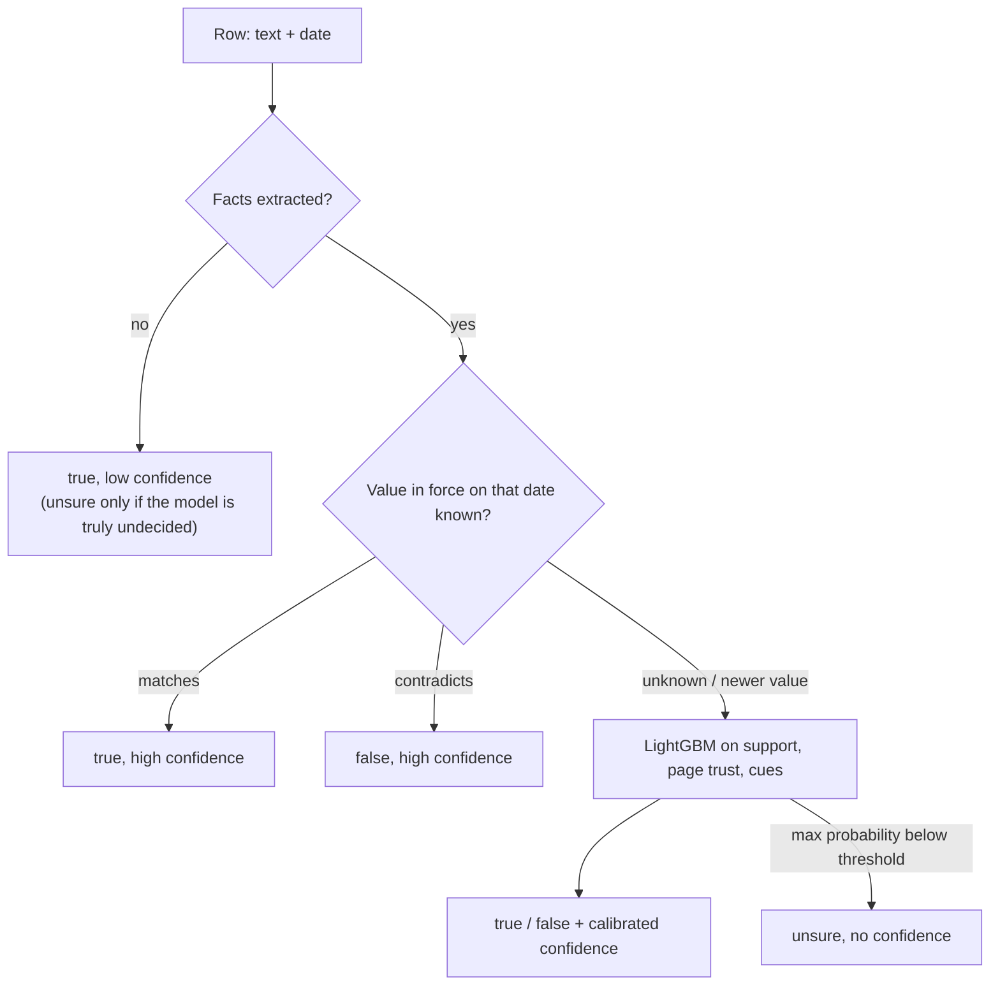
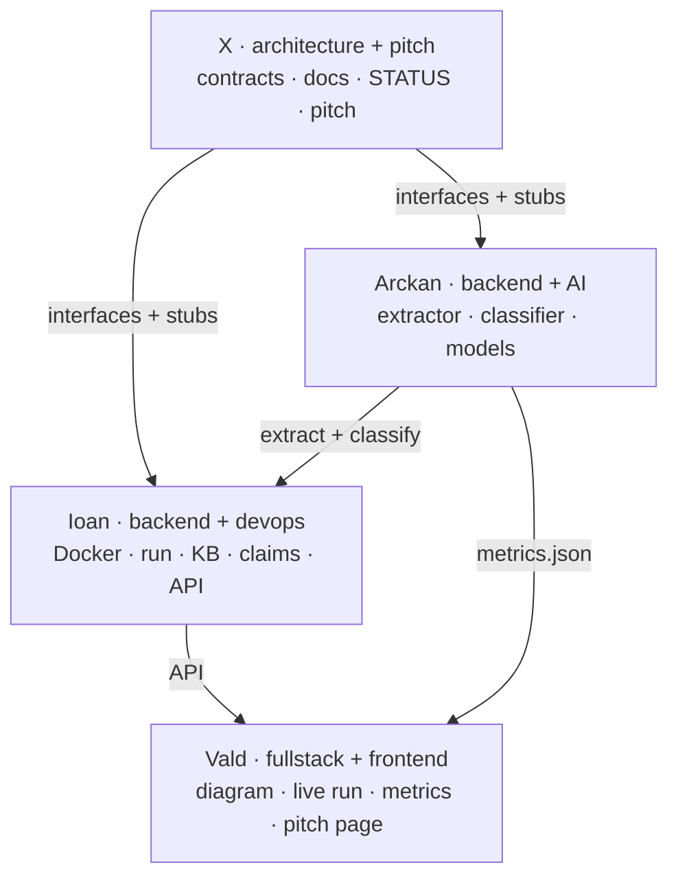

# Hype Arena starter

## [hype-arena.vercel.app](https://hype-arena.vercel.app/)

## The universe

**Hooly** is a fictional company in a fictional universe, made for the QA DNA challenge of the NEXXT AI Hackathon. Its name alludes to Hooli, the tech giant of the TV series *Silicon Valley*. Its products carry the names of real Google products, used fictitiously: nothing here describes those products or their makers. Its people carry the names of the series' characters with a few letters changed.

Hooly's people, events, decisions and figures are invented, and the universe departs from the series and from Google's real history on purpose. **The truth is what the universe says.** A system that fills gaps from the web, or from what a pretrained model already knows, learns facts the universe contradicts.

The universe is a year of Hooly's pages, docs, posts, decks and press releases, in which prices, headcounts, dates and names change, and some pages lie. You get a part of it as sentences, each labelled.

## The task

Build a system that does two things with rows about Hooly, each with how sure your system is:

- **It labels rows.** Given rows of the universe, some labelled and some not, it labels each unlabelled row `true`, `false` or `unsure`.
- **It writes new content.** It writes exactly 1,000 new claims about Hooly that connect what the universe says, every one of them true.

How you build it is yours to decide.

- **LLMs may help you build your system,** and make what it learns from, but the system itself may not be an LLM.
- **Fork this repository and work in your fork,** so we can follow your work. Forks are public.
- **Your system has a frontend:** a working page that shows the architecture of your system as a diagram and runs the system live on rows you give it. Start it however you like: your video shows it running.
- **At 09:00 on 29 Oct we add a sample of 20 rows to this repository,** as one CSV file, `sample/sample.csv`: new rows, in the shape of the run's input with every `label` empty (`id`, `text`, `date`, `label`). The video you hand in at 11:00 shows your frontend running your system live on them, beside its architecture diagram.
- **Your submission is a pull request** from your fork to this repository, one per team, titled with your team's name and opened before 11:00 on 29 Oct. It holds both the `Dockerfile` we run your system from, as [`contracts/README.md`](contracts/README.md) says, and what starts your frontend. What it holds at 11:00 is what we run: a push to it, or closing it, after 11:00 disqualifies the team.
- **We run every team's system** after 11:00, offline, for up to 30 minutes, on about 20,000 rows of the universe, the practice rows among them with their labels. It hands in one table, `/output/output.csv`: a label for each of the roughly 18,000 unlabelled rows and exactly 1,000 new claims, every one true, and we judge both. How it runs, what it reads and what it hands in is in [`contracts/README.md`](contracts/README.md).

## What is here

| Path | What |
| --- | --- |
| `data/practice.csv` | The practice dataset: one row per sentence of the practice part of the universe, each labelled `true`, `false` or `unsure`, with the facts it states |
| `data/lexicon.json` | The subjects the dataset names, with their aliases and attributes, and the events |
| `contracts/` | What you get, how we run your system and what it hands in |
| `sample/sample.csv` | From 09:00 on 29 Oct: the 20 rows of the sample, unlabelled |
| `scripts/check.sh` | Runs your system as we will, on the practice data, and checks its table |

## Check your system

`scripts/check.sh` builds the image from your `Dockerfile` and runs it as we will: offline, as user 10001, on a read-only root, with 2 CPUs and 6 GiB, until it exits or 30 minutes pass. Its input is the practice dataset in the run's shape, with every fifth row's label hidden. It then checks your table's columns, ids, lengths, labels and confidences, that it holds exactly 1,000 new claims, and counts your labels on the hidden rows against the practice labels. It needs Docker and Python 3.

It does not check a claim's text against `claim-forms.md`, its form against `entry.schema.json`, or its names against the lexicon: we check those after the run. And an image that holds `data/practice.csv` knows the hidden labels, so the label count here is an upper bound.

```sh
scripts/check.sh                 # build the image and run it
scripts/check.sh my-image:tag    # run an image you built
MINUTES=5 scripts/check.sh       # a shorter run
```

A run that passes here can still fail ours on what the practice data does not hold.

---

## Team Tzatziki — how our system is supposed to work

*Added by Team Tzatziki. Everything above this line is the original starter text.*
More detail: [`docs/ARCHITECTURE.md`](docs/ARCHITECTURE.md), [`docs/REQUIREMENTS.md`](docs/REQUIREMENTS.md), [`docs/EDA.md`](docs/EDA.md), [`team/README.md`](team/README.md).

### The pipeline



### One run inside Docker (offline, 2 CPUs, 6 GiB, 30 min)



### How a row gets its label



### Who builds what (4 Claude Code agents in parallel)



Everyone appends one line per meaningful commit to `pitch/JOURNAL.md`; X turns it into the live pitch.
