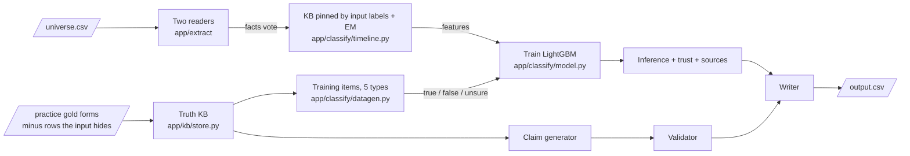

# Architecture — Hype or Truth (Team Tzatziki)

> Team mapping: **P1 = X** (architecture + pitch) · **P2 = Ioan** (backend + devops) · **P3 = Arckan** (backend + AI) · **P4 = Vald** (fullstack + frontend). Prompts live in `team/`.

**What the challenge wants:** one offline, non-LLM system that (1) decides for each of ~18,000 sentences
about Hooly whether it is true on its date, with a calibrated confidence, and (2) writes 1,000 brand-new,
provably true claims in a strict structured + textual format. Plus a frontend that shows this
architecture and runs it live.

**Our answer:** turn text into facts, put facts on a timeline, judge new facts against the timeline,
and generate claims only from what the timeline firmly supports.

## What runs now (integrated pipeline, 29 Oct, branch `john`)

The sections after this one are the first design; this one is what `python -m app.run` and the demo API do.



| Step | What it does | Where |
|---|---|---|
| Two readers | Arckan's ranker extracts every row (fact F1 0.838 on holdout pages); X's simple extractor reads it again and a fact both read gets more weight (precision 0.953). Practice rows are read by models that never saw their page (5 page folds), so training rows look like inference rows. | `app/extract/` |
| KB pinned by input labels + EM | Only the input's labelled rows pin it (true -> its gold form holds; false with one fact -> forbidden); unlabelled rows vote, weighted by page trust (EM from a text-only prior); a staircase per subject+attribute (a new value needs a pin or 2 pages). Generated items never pin or vote. A labelled row's own features come from a KB without its page's labels (5 page folds), read from its extracted facts like any unlabelled row. Values compare with units converted, a bound includes its value (`key_inclusive`), rows of one date in row order. `TZ_KB_LABELS=0`: label-free. | `app/classify/timeline.py`, `model.py` |
| Truth KB | Gold forms of practice rows, except rows whose label the input hides (no leak). Source of truth for claims and training items. | `app/kb/store.py` |
| Training items | true = validated claim candidates (one per meaning; a fact that only rewords one prose sentence is skipped), false = the same claim with its logic flipped, unsure = pairs no gold row states (the subject's or its siblings' attributes). | `app/classify/datagen.py` |
| Train / infer | LightGBM (research's frozen hyperparameters) on the labelled rows + items. `TZ_MODE=prod` trains on all items; `debug` holds half out and scores them. Each label gets a confidence (0.5–1, empty for unsure), a trust score and its supporting / contradicting rows (aux `classifier.json`, never in output.csv). | `app/classify/` |

Measured: `scripts/check.sh` (Docker, offline, read-only, user 10001, 2 CPUs) green, 380/380 hidden rows labelled,
~87 % right (all-true: 85 %); debug accuracy on held-out generated items 98.1 % with the pinned KB (89.6 % label-free):
the generated items take their truth from the same labels that pin the KB, so debug measures judgement with the
evidence present, not the hidden-row case.

**Ideas noted, not applied yet (29 Oct, Ioan):** today the label is the model's argmax and the trust score is only an
explanation. To try next, measured in debug before keeping any:
- a sentence with 0 % support from other pages (no other page states its value) should lean towards **unsure**;
- a trust score below 50 % should pull the confidence towards **false** (or lower the confidence of a true label);
- similar adjustments: let the trust parts (page trust, support, extraction) feed the decision, e.g. as model
  features or a post-hoc rule, and calibrate `confidence` on the held-out generated half (no calibration step yet). Research behind it: `eda/07_improve.py` (X).

## Pipeline

```mermaid
flowchart LR
  U[/universe.csv + lexicon.json/] --> X

  subgraph X[Extractor · P3]
    X1[Subject gazetteer<br/>names + aliases] --> X4
    X2[Value regexes<br/>value-forms.md] --> X4
    X3[Attribute classifier<br/>TF-IDF + LogReg] --> X4
    X4[Page coreference<br/>He / Its / The platform]
  end

  X --> F[(Facts<br/>subject · attribute · value · date)]
  G[/practice.csv gold forms/] --> KB
  F --> KB

  subgraph KB[Temporal Knowledge Base · P2]
    K1[Timeline per subject+attribute]
    K2[Support votes across universe]
    K3[Page trust]
  end

  KB --> C
  F --> C
  subgraph C[Truth classifier · P3]
    C1[Features: agrees with value in force,<br/>contradicts, support, page trust, kind…]
    C2[LightGBM]
    C3[Isotonic calibration → 0.5–1]
    N1[[Optional: CfC liquid net<br/>value-still-current prob]]:::opt
    C1 --> C2 --> C3
    N1 -.-> C1
  end

  KB --> GEN[Claim generator · P2<br/>fact · compare · change · at_event · relation]
  GEN --> V[Validator · P2<br/>schema · lexicon · claim-forms rules · novelty]
  V -- invalid → regenerate --> GEN
  C3 --> W[Writer · P2<br/>tmp → rename]
  V -- exactly 1,000 --> W
  W --> O[/output/output.csv/]

  O -.-> API[FastAPI /run /architecture /metrics · P2] -.-> FE[Frontend · P4<br/>diagram · live run · metrics · /pitch]
  classDef opt stroke-dasharray: 5 5
```



## Components
| Component | Folder | Owner | In | Out |
|---|---|---|---|---|
| Contracts & stubs | `app/contracts.py` | P1 | — | dataclasses `Fact`, `Label`, `Claim`, stub functions |
| Runner | `app/run.py` | P2 | `/universe` | `/output/output.csv`, timings |
| I/O | `app/io/` | P2 | CSV | rows; safe atomic writer |
| Extractor | `app/extract/` | P3 | rows, lexicon | `list[Fact]` |
| Temporal KB | `app/kb/` | P2 | facts + gold | `lookup(subject, attr, date)`, feature helpers |
| Truth classifier | `app/classify/` | P3 | rows, facts, KB | `list[Label]` |
| Neuromorphic (opt.) | `app/neuro/` | P3 | KB timelines | `cfc_current_prob` feature |
| Claim generator | `app/generate/` | P2 | KB, lexicon, input texts | `list[Claim]` |
| Validator | `app/validate/` | P2 | claim | list of problems |
| Demo API | `app/api/` | P2 | CSV upload / sample | JSON for frontend |
| Frontend | `frontend/` | P4 | API | diagram, live run, metrics, pitch |
| Models | `models/` | P3 | `train/train.py` | `*.joblib` |
| Pitch | `pitch/` | P1 (+ everyone appends JOURNAL) | commits, metrics | `PITCH.md` slides |

## Interfaces
```python
@dataclass
class Fact:  row_id: str; subject: str; attribute: str; value: dict; span: str; conf: float
@dataclass
class Label: id: str; label: Literal["true","false","unsure"]; confidence: float | None
@dataclass
class Claim: id: str; type: str; text: str; form: dict; confidence: float

def extract(rows: list[dict], lexicon: dict) -> list[Fact]
class KB:
    def build(self, facts: list[Fact], gold_rows: list[dict]) -> None
    def lookup(self, subject: str, attr: str, date: str) -> tuple[dict | None, float, list]
def classify(rows: list[dict], facts: list[Fact], kb: KB) -> list[Label]
def generate(kb: KB, lexicon: dict, input_texts: set[str], n: int = 1000) -> list[Claim]
def validate_claim(claim: Claim, lexicon: dict, input_texts: set[str]) -> list[str]
```
API: `POST /run` → `{labels, claims, facts, timings, stages}` · `GET /architecture` → `{nodes, edges}` · `GET /metrics` → `pitch/metrics.json`.

## Runtime budget (2 CPUs, 6 GiB, 30 min, offline)
| Stage | Target |
|---|---|
| Fallback table written | < 60 s |
| Load + extract 20k rows | < 4 min |
| KB build | < 1 min |
| Classify + calibrate | < 2 min |
| Generate + validate 1,000 claims | < 3 min |
| Final write (tmp → rename) | < 10 s |
| Safety margin before deadline | ≥ 15 min |

Image target < 1.5 GB (python-slim + sklearn + lightgbm; + ~250 MB if torch-CPU/ncps ship). Memory target < 3 GB.

## Failure strategy
Every stage is wrapped: if it raises, the runner falls back to the previous output or stub. A watchdog
writes the best-so-far table at `ARENA_DEADLINE − 90 s`, and a SIGTERM handler writes again. A run
never ends without `/output/output.csv`.
