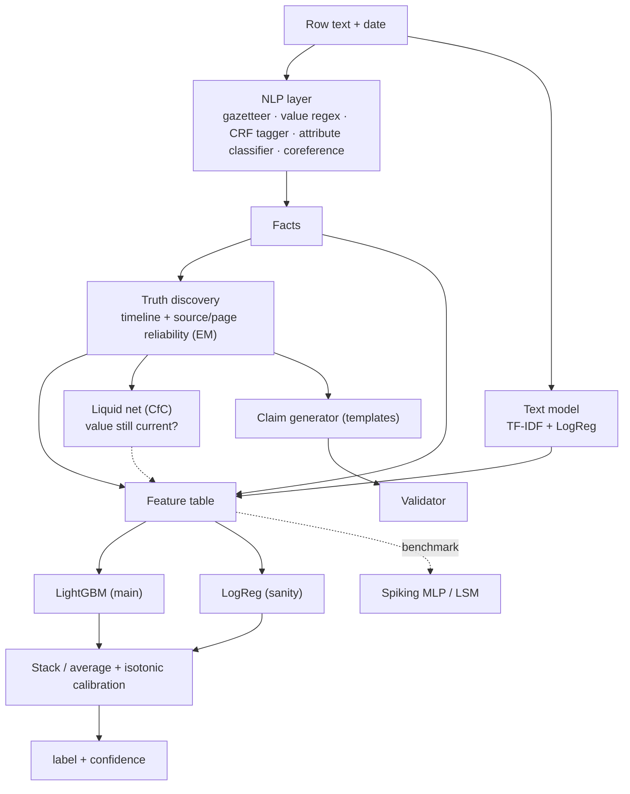

# Models & approach — Hype or Truth (Team Tzatziki)

> Owner: **Arckan** (P3) builds; **Ioan** (P2) owns the KB/generator side; **X** pitches it; **Vald** shows the comparison.
> Constraints every model must respect: **no LLM inside the system**, offline, 2 CPUs, 6 GiB RAM, image ≤ 3 GiB,
> whole run ≤ 30 min on ~20k rows, only ~1,900 labelled rows. Evidence = the Hooly universe only.

## The approach in one sentence
**Read facts out of text (NLP), put them on a timeline and estimate which sources are trustworthy (truth
discovery), then let a small calibrated classifier decide true/false — and generate claims only from facts the
timeline firmly supports.** Neural / neuromorphic models are added as *extra signals*, never as the backbone.

---

## 1. NLP layer — text → facts (biggest lever: everything downstream depends on it)
| Step | Model (in order of priority) | Why | When |
|---|---|---|---|
| Subject spotting | **Lexicon gazetteer**, longest match, case-insensitive (Aho-Corasick or regex alternation) | Lexicon is closed (62 subjects + 48 aliases); exact rules beat ML | T1 |
| Value spotting | **Regex per kind** written from `value-forms.md` (money, quantity+unit, percent, duration, date, version, yes/no via negation; detect approximations/ranges/comparisons) | Formats are specified exactly; rules are precise and explainable | T1 |
| Value span refinement | **CRF sequence tagger** (`sklearn-crfsuite`, BIO tags for SUBJ/VALUE/UNIT) trained on practice forms aligned to text | Catches odd phrasings the regex misses; tiny, fast on CPU | overnight |
| Attribute | **TF-IDF (word 1–2 + char 3–5, value masked) → LogisticRegression / LinearSVC**, restricted to the subject's lexicon attributes; features + value kind + unit noun | 321 attributes, short sentences; linear models are strong here and calibrate well | T1→T2 |
| Attribute (alt.) | **word2vec / fastText trained from scratch on the universe text** (gensim), averaged vectors → LogReg | Learns Hooly synonyms ("crew" ≈ team_size) without any outside knowledge | overnight |
| Coreference ("He", "Its", "The platform") | **Rule: nearest prior subject on same page compatible with attribute**, then a **LogReg ranker** over candidate antecedents (distance, kind fit, attribute fit) | 754 facts need it; page = same date + adjacent ids | T2 |
| Multi-fact rows | Split on clause boundaries; one fact per value found | 23% of rows hold ≥ 2 facts; any false value ⇒ row false | T2 |

**Metric:** fact-level precision / recall vs gold `form` (grouped CV). Target ≥ 0.85 F1 on (subject, attribute, value).

> ⚠️ **Pretrained transformers (BERT, MiniLM, spaCy-trf):** a small encoder is arguably *not* an LLM, but the rules
> say "may not be an LLM" and "don't rely on facts a pretrained model knows". **Default: don't ship one.** Only consider
> a tiny sentence encoder (ONNX, < 100 MB) for attribute matching if extraction F1 is stuck — and ask the organisers first.

## 2. Classic ML — facts → label + confidence
| Model | Role | Notes |
|---|---|---|
| **Majority "true" baseline** | floor | 83.3% accuracy — anything worse is broken |
| **TF-IDF + LogReg on text only** | baseline + one stacked feature | captures "hype" cues ("more than any competitor", speaker quotes) |
| **Truth discovery (TruthFinder / Dawid-Skene-style EM)** | KB core (Ioan + Arckan) | iteratively estimates *value truth* per (subject, attribute, date window) and *reliability* per page/source; output = `p_value_true`, `page_reliability` features |
| **LightGBM** (main) | final classifier | features: agrees with value in force, contradicts it, newer-than-known, support for/against, page reliability, text-model prob, kind, n facts, extraction conf, cue words, (CfC prob). Small trees: `num_leaves 15–31`, `min_data_in_leaf 20`, class weights for false |
| **LogisticRegression** on the same features | sanity + ensemble member | interpretable, robust when LightGBM overfits |
| **ExtraTrees / CatBoost** *(optional)* | ensemble member | only if CV shows gain; CatBoost adds ~100 MB |
| **Stacking / mean of probs → isotonic calibration** | confidence | confidence = calibrated P(label) clipped to [0.5, 1]; `unsure` only below an OOF-tuned threshold (rare, 2% in practice) |

**Validation:** GroupKFold by page/date; KB rebuilt **without** held-out labels each fold. Report accuracy,
**macro-F1** (false class matters), **ECE** + reliability curve, runtime.

## 3. Claim generation — no ML needed to *write*, ML to *choose*
Templates per type exactly per `claim-forms.md` / `value-forms.md` (Ioan). ML's job is **selection**: rank candidate
claims by `p_value_true` from truth discovery × LightGBM-style confidence that the fact holds on the as-of date;
take the top 1,000 that pass the validator, with type/subject diversity quotas. Confidence = that score (≥ 0.6).

## 4. Liquid neural networks (LNN) — the time-aware signal
Our data *is* irregular time series: each (subject, attribute) is a stream of mentions at uneven dates.
| Model | Input | Output | Verdict |
|---|---|---|---|
| **CfC (closed-form continuous-time, `ncps`)** | per pair: sequence of (Δdays since last mention, agrees-with-KB, page reliability, value-changed flag, kind one-hot) | P(value still current at date t) → feature `cfc_current_prob` | **Recommended experiment** — handles irregular Δt natively, tiny (≈ 5–20k params), fast on CPU |
| **LTC (liquid time-constant)** | same | same | compare to CfC; slower (ODE solver), keep only if better |
| **GRU baseline** | same | same | control: shows whether "liquid" adds anything over a plain RNN |

Reuse: `neuromorphic-gestures/learn/_lib/models.py` (`build("cfc"|"ltc"|"gru", …)`, `SeqNet`), `trainer.fit`.
Ship behind `USE_NEURO=1` **only if** grouped CV improves macro-F1/ECE and inference < 2 min. torch-CPU + ncps ≈ 250 MB.

## 5. Spiking neural networks (SNN) & neuromorphic — benchmark + pitch, not backbone
| Model | Input | Use |
|---|---|---|
| **Spiking MLP (snnTorch LIF, surrogate gradients)** | the LightGBM feature table, **rate- or latency-encoded** (`common.rate_encode`) | benchmark row: accuracy vs LightGBM, **synaptic ops / energy estimate** (`compare.py` `synops`) |
| **Liquid State Machine (reservoir of spiking neurons + linear readout)** | per-pair event stream as spikes (one spike per mention, channels for agree/contradict) | cheap temporal benchmark; readout = LogReg — trains in seconds |
| **NIR export** (`export_nir.py`) | the trained SNN | pitch: "this verifier is chip-ready (Loihi/SpiNNaker-class), ~N× fewer ops than dense" |

**Why not the backbone:** the task is symbolic lookup + reasoning over time; ~1,900 labels; a 2-CPU x86 box gets
no speed-up from spikes. **Why do it anyway:** honest comparison table + energy story = strong, differentiating
pitch slide ("Classic vs Liquid vs Spiking").

## 6. Order of work (Arckan, with Ioan on the KB)
| Milestone | Deliver |
|---|---|
| **T1 16:00** | baselines (majority, TF-IDF+LogReg); gazetteer + regex extractor v0; extraction F1 reported |
| **T2 22:00** | attribute classifier + coreference; truth-discovery features (with Ioan's KB); LightGBM + LogReg + isotonic → shipped |
| **overnight** | CRF tagger, universe word2vec, ensemble; **then** CfC/LTC/GRU feature (2 h box); SNN + LSM benchmark (1 h box); NIR export |
| **T3 08:30** | freeze best config; `pitch/metrics.json` has keys `baseline`, `extraction`, `model`, `calibration`, `neuro` |

## 7. Comparison table to fill (→ `pitch/metrics.json` → Vald's /metrics → X's slide)
| Model | Macro-F1 | Accuracy | ECE | Inference 20k rows | Params / size | Ships? |
|---|---|---|---|---|---|---|
| Majority "true" | | 0.833 | — | 0 s | 0 | no |
| TF-IDF + LogReg (text only) | | | | | | stacked feature |
| KB + LogReg | | | | | | ensemble |
| **KB + LightGBM (+ calibration)** | | | | | | **yes (default)** |
| + CfC feature | | | | | | if better |
| LTC / GRU feature | | | | | | control |
| Spiking MLP | | | | | synops | benchmark |
| LSM reservoir | | | | | | benchmark |
