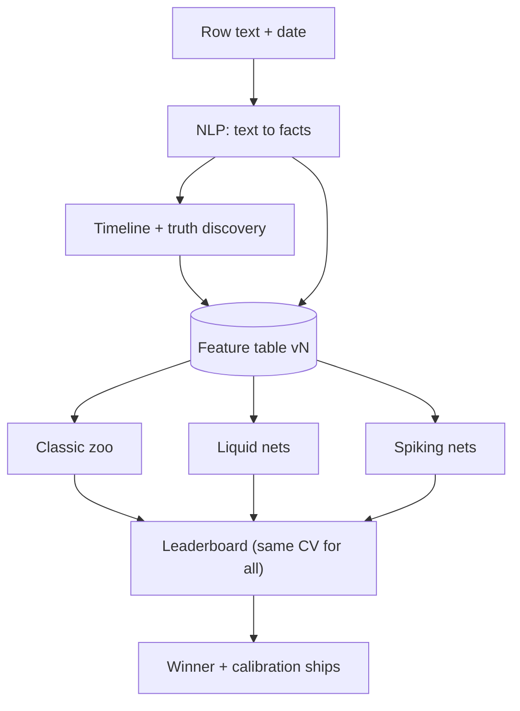

# Models & approach v2 — Hype or Truth (Team Tzatziki)

> **Owners:** Arckan (P3) builds the models. Ioan (P2) owns the KB and the truth-discovery hook. X (P1) pitches, and takes over neuro
> training if it needs too much compute (see §6). Vald (P4) shows the leaderboard.
> **Constraints on what ships:** no LLM inside the system, offline, 2 CPUs, 6 GiB, image ≤ 3 GiB, the whole run ≤ 30 min on ~20k rows, and only
> ~1,900 labelled rows. Everything else in this file is **dev-time experimentation**: we test many methods, but only the winning config ships.

## The approach in one sentence
Read facts out of the text (NLP), put them on a timeline and estimate which sources are trustworthy (truth discovery), then
let the best model from a wide, fairly compared **model zoo** (classic, liquid, spiking) decide true/false with calibrated
confidence. Claims are generated only from facts the timeline firmly supports.

## 1. NLP layer: text → facts
| Step | Model | When |
|---|---|---|
| Subject spotting | Lexicon gazetteer, longest match | T1 |
| Values | Regex per kind, written from `value-forms.md` | T1 |
| Attribute | TF-IDF (word + char, value masked) → LogReg / LinearSVC, restricted to the subject's attributes | T1→T2 |
| Coreference | Rule: nearest compatible subject on the same page → LogReg antecedent ranker | T2 |
| Span refinement | CRF tagger (`sklearn-crfsuite`) | overnight |
| Synonyms | word2vec/fastText trained **from scratch on the universe** (gensim) | overnight |
| **Gated fallback** | MiniLM sentence encoder (ONNX, < 100 MB). **Only if** extraction F1 < 0.80 after CRF + word2vec, **and** only after QA DNA confirms it's allowed | only if stuck |

Metric: fact-level P/R/F1 vs the gold `form`, grouped CV.

## 2. Truth discovery (built, then ablated)
Ioan's KB exposes per-pair timelines with source ids (page = date + adjacent ids). Arckan adds an **EM loop**
(TruthFinder / Dawid-Skene style) that alternates between estimating value truth and estimating page reliability. Its outputs are
`p_value_true` and `page_reliability`.
**Ablation:** every model on the leaderboard is run **with and without** these features. They stay only if CV improves.

## 3. Classic model zoo (same features, same folds, one registry `train/experiments.py`)
| Family | Models & settings |
|---|---|
| Linear | LogReg L1 / L2 / elastic-net; **SVM linear + RBF, C sweep** (small C = soft margin, large C ≈ hard margin), Platt for probabilities |
| Neighbours / Bayes | **KNN** (k = 3…51, uniform vs distance weights, scaled features); Complement Naive Bayes on text |
| Trees | RandomForest, ExtraTrees, **LightGBM**, XGBoost *or* CatBoost (one, if the image size allows) |
| Neural (classic) | sklearn MLPClassifier |
| Ensembles | **Stack:** LightGBM + LogReg → OOF LogReg meta-learner; **big ensemble:** + SVM + ExtraTrees + KNN (+ boosted #2), soft voting vs stacking |

## 4. Validation & tuning techniques
- **Splits:**
  - GroupKFold by page (default).
  - StratifiedGroupKFold.
  - **Time-forward split:** train on earlier dates, test on later ones, which matches how truth changes over time.
  - Repeated CV (3×5) for stable means ± std.
  - **Nested CV** for honest scores after tuning.
- **No leaks:** the KB and truth-discovery features are rebuilt **without the held-out fold's labels**.
- **Tuning:** Optuna (dev-time only) or HalvingRandomSearchCV, with the budget capped per model.
- **Imbalance:** class weights vs SMOTE (compared).
- **Calibration:** isotonic vs Platt vs temperature, chosen by **ECE**. Confidence is clipped to [0.5, 1]; `unsure` only below an OOF-tuned threshold.
- **Explainability:** feature-group ablation, permutation importance, SHAP on the winner (for the pitch).
- **Metrics:** macro-F1 (main), accuracy, ECE, Brier, inference time on 20k rows, model size.

## 5. Neuro track: liquid + spiking (both "feature" and "full classifier")
| Model | As a feature | As a classifier (ensemble member) |
|---|---|---|
| **CfC** (`ncps`) | per-pair irregular timeline (Δdays, agree, page trust, changed, kind) → `cfc_current_prob` | row-level: the row's pair timeline up to its date + row features → true/false |
| **LTC** | same as CfC (slower ODE; keep only if better) | same |
| **GRU** | control: does "liquid" beat a plain RNN? | control |
| **Spiking MLP** (snnTorch LIF, surrogate gradients) | — | feature table, rate vs latency encoding |
| **LSM reservoir** (spiking reservoir + linear readout) | per-pair spike streams → readout prob | readout = classifier |
| **NIR export + synops** | — | pitch: "chip-ready", energy vs dense |

The reference code is `neuromorphic-gestures/learn/_lib/` (`models.build("cfc"|"ltc"|"gru"|"snn_mlp"|"lsm")`, `trainer.fit`,
`common.rate_encode`, `compare.synops`) and `export_nir.py`. **Copy the minimal pieces; never import from outside the repo.**
Dependencies go in `requirements-neuro.txt` (torch-CPU, ncps, snntorch, nir). They ship only via the Docker build arg `WITH_NEURO=1` if a neuro model wins.

## 6. Neuro compute handoff (Arckan ↔ X, in parallel)
1. **Arckan publishes a frozen feature table** whenever features improve: `train/features/features_vN.parquet`,
   `train/features/timelines_vN.parquet` and `train/features/SCHEMA.md` (columns, fold ids, label encoding).
2. **Default:** Arckan runs neuro in `train/neuro/`.
3. **Trigger:** a neuro run takes > 15 min on his laptop, **or** Arckan is behind T2. Arckan writes in STATUS.md:
   `@X from Arckan: neuro handoff, features_vN`.
4. **After the handoff**, X owns `train/neuro/` and `models/neuro/`, and Arckan keeps `app/neuro/__init__.py`
   (`neuro_features(rows, kb)`, `neuro_predict(rows, kb)`).
5. **Sync:** X pulls the latest `features_vN` before every run, logs each run in `train/neuro/LOG.md`, adds a row to
   `train/results.csv` (same CV folds), and commits weights to `models/neuro/` (< 50 MB). Arckan wires a neuro model in when it
   wins. **Nobody waits:** X always trains on the newest table available.

## 7. Leaderboard → ship decision
`train/results.csv` → `pitch/metrics.json["leaderboard"]` → Vald's `/metrics` (sortable) → X's slide.

| model | track | features (± TD) | CV scheme | macro-F1 | acc | ECE | infer 20k | size | ships? |
|---|---|---|---|---|---|---|---|---|---|

**Ship rule:** the best macro-F1 (ties → lower ECE) **that passes the runtime gate**: inference < 5 min on 2 CPUs, image ≤ 3 GiB,
time-forward CV no worse than −2 points vs grouped CV. The fallback is always the LightGBM + LogReg stack.

## 8. Order of work
| Milestone | Arckan | X (after handoff) |
|---|---|---|
| T1 16:00 | baselines, extractor v0, extraction F1, `features_v1` | — |
| T2 22:00 | full extractor, TD features, **stack** shipped, zoo started | — |
| overnight | zoo + CV techniques + tuning, TD ablation, CfC/LTC/GRU feature | CfC/LTC classifier, SNN, LSM, NIR (if handed off) |
| T3 08:30 | freeze the winner, leaderboard final | neuro rows final in the leaderboard |

## 9. Measured status (28 Oct, leak-free)
Protocol and full tables: [`tests/runtime/README.md`](../tests/runtime/README.md) ("Rezultate măsurate"). Research index: [`eda/README.md`](../eda/README.md).

| Model (`eda/07_improve.py`, `09`, `11`) | CV gold facts (oracle) | CV extracted facts | Holdout extracted | 300 statements (gold / extracted) |
|---|---|---|---|---|
| all true | 0.836 | 0.834 | 0.802 | 0.333 / 0.385 |
| **L0 (plain LightGBM)** | 0.873 | **0.867** | **0.846** | 0.530 / 0.476 |
| L4 (improvement ladder) | 0.895 | 0.858 | 0.827 | 0.593 / 0.407 |

- **Ship L0, not the ladder.** The ladder wins only with gold facts; with extracted facts and on the holdout it loses to L0.
- **Overfit:** 100% train accuracy on every fold (gap 13–14 points); stronger regularisation does not raise validation.
- **No gain:** learned word values (`eda/09_word_values.py`) and fact-chain features (`eda/11_fact_chains.py`) add ~0.
- **Next levers:**
  1. An extractor trained on `form` (train-time only: the arena input has no `form`). Extraction costs 3.7 points.
  2. Ioan's ~10k synthetic dataset, through `eda/12_train_synth.py`: training only, scored on real rows.
- **Always** validate on `data/hooly_statements_300.csv` with `eda/10_h300_validation.py`. Report extracted-facts numbers next to all-true; gold-`form` numbers are oracle only.
