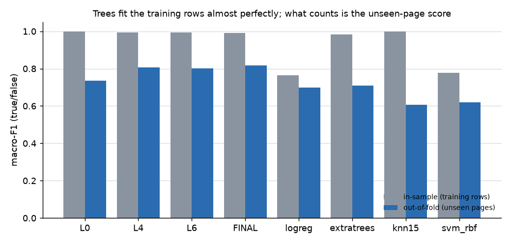
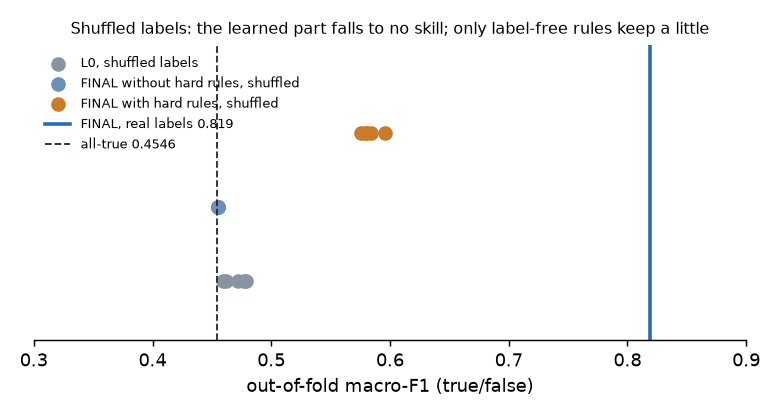
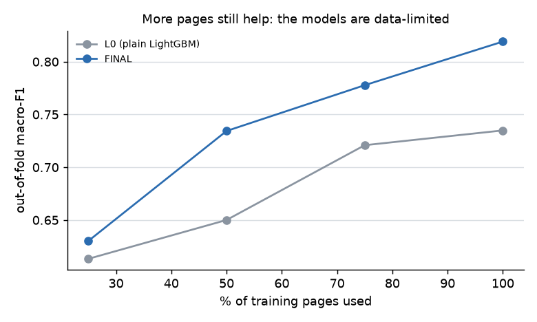

# Overfitting audit of the label models

*Generated by `eda/11_overfit.py` on 2026-10-28 16:49. Folds: `eda/splits.csv` `fold_group` (5 folds by page, holdout pages excluded). FINAL = L6 + timeline vote window 45 days + LightGBM `min_child_samples` 20. No new holdout scores: test 2 reads the numbers recorded earlier.*

## Verdicts

| model | test | value | threshold | verdict | note |
|---|---|---|---|---|---|
| FINAL | 1 train-vs-test gap (macro-F1) | 0.1731 | > 0.10 = WARN | WARN | train 0.991 / out-of-fold 0.818 |
| L0 | 1 train-vs-test gap (macro-F1) | 0.2656 | > 0.10 = WARN | WARN | train 1.000 / out-of-fold 0.734 |
| L4 | 1 train-vs-test gap (macro-F1) | 0.1869 | > 0.10 = WARN | WARN | train 0.993 / out-of-fold 0.806 |
| L6 | 1 train-vs-test gap (macro-F1) | 0.1921 | > 0.10 = WARN | WARN | train 0.993 / out-of-fold 0.801 |
| extratrees | 1 train-vs-test gap (macro-F1) | 0.2716 | > 0.10 = WARN | WARN | train 0.982 / out-of-fold 0.711 |
| knn15 | 1 train-vs-test gap (macro-F1) | 0.3947 | > 0.10 = WARN | WARN | train 1.000 / out-of-fold 0.605 |
| logreg | 1 train-vs-test gap (macro-F1) | 0.0664 | > 0.10 = WARN | PASS | train 0.765 / out-of-fold 0.698 |
| svm_rbf | 1 train-vs-test gap (macro-F1) | 0.1566 | > 0.10 = WARN | WARN | train 0.776 / out-of-fold 0.620 |
| L0 | 2 CV-vs-holdout gap (macro-F1) | -0.0084 | > 2 x holdout SE = WARN | PASS | CV 0.735 / holdout 0.743 / SE 0.044 |
| L4 | 2 CV-vs-holdout gap (macro-F1) | 0.0734 | > 2 x holdout SE = WARN | PASS | CV 0.806 / holdout 0.733 / SE 0.043 |
| FINAL | 2 CV-vs-holdout gap (macro-F1) | 0.0746 | > 2 x holdout SE = WARN | PASS | CV 0.819 / holdout 0.745 / SE 0.043 |
| FINAL | 3 label permutation: learned part (max of L0 / FINAL without hard rules, 5 runs) | 0.4791 | <= 0.50 else FAIL (leakage) | PASS | L0 mean 0.470, FINAL without rules mean 0.455; all-true 0.4546 |
| FINAL | 3b label-free floor: FINAL with hard rules on shuffled labels (mean) | 0.5831 | info | INFO | the hard rules read label-free timeline votes, so they keep some skill without labels |
| L0 | 4 learning curve (75% -> 100% gain) | 0.0140 | > 0 = still data-limited | PASS | 25% 0.613 / 50% 0.650 / 75% 0.721 / 100% 0.735 |
| FINAL | 4 learning curve (75% -> 100% gain) | 0.0413 | > 0 = still data-limited | PASS | 25% 0.630 / 50% 0.734 / 75% 0.778 / 100% 0.819 |
| FINAL | 5 seed stability (std macro-F1) | 0.0026 | > 0.01 = WARN | PASS | mean 0.8151, range 0.8124-0.8191 |
| FINAL | 6 selection bias (gain vs expected max noise) | 0.0842 | > 0.011 (noise max) | PASS | 103 variants, trial SE 0.0035 |
| FINAL | 6 nested check: tau_days pick wins on the unseen fold | 4.0000 | >= 3 of 5 | PASS |  |
| FINAL | 6 nested check: min_child_samples pick wins on the unseen fold | 3.0000 | >= 3 of 5 | PASS |  |
| FINAL | 7 gain vs L0 on fold_group | 0.0842 | > 0 | PASS | L0 0.735 / FINAL 0.819 |
| FINAL | 7 gain vs L0 on fold_row5 | 0.0699 | > 0 | PASS | L0 0.757 / FINAL 0.827 |
| FINAL | 7 gain vs L0 on time_split | 0.0699 | > 0 | PASS | L0 0.637 / FINAL 0.707 |
| FINAL | 8 archetypes worse than L0 by > 0.05 (n >= 20, >= 3 false) | 1.0000 | 0 | WARN | lying_page -0.275 |

## 1. Train vs test

In-sample = the model's LightGBM scored on its own training rows (hard rules applied for L4 and later; the calibrator is not refitted). A big in-sample score is normal for boosted trees; the question is whether the out-of-fold score holds up, which tests 2–7 check.

| model | train_f1 | test_f1 | train_acc | test_acc | gap_f1 |
|---|---|---|---|---|---|
| FINAL | 0.9913 | 0.8182 | 0.9956 | 0.8970 | 0.1731 |
| L0 | 1.0000 | 0.7344 | 1.0000 | 0.8727 | 0.2656 |
| L4 | 0.9928 | 0.8059 | 0.9964 | 0.8941 | 0.1869 |
| L6 | 0.9928 | 0.8007 | 0.9964 | 0.8918 | 0.1921 |
| extratrees | 0.9821 | 0.7105 | 0.9818 | 0.8757 | 0.2716 |
| knn15 | 1.0000 | 0.6053 | 1.0000 | 0.8586 | 0.3947 |
| logreg | 0.7647 | 0.6984 | 0.8915 | 0.8419 | 0.0664 |
| svm_rbf | 0.7765 | 0.6198 | 0.9021 | 0.8606 | 0.1566 |

## 2. CV vs holdout

The holdout (43 pages, 304 rows) was scored once per model earlier. Its page-bootstrap standard error is about 0.03, so only gaps beyond ~0.06 are clear.

| model | cv_f1 | holdout_f1 | holdout_se | gap |
|---|---|---|---|---|
| L0 | 0.7349 | 0.7433 | 0.0441 | -0.0084 |
| L4 | 0.8061 | 0.7327 | 0.0430 | 0.0734 |
| FINAL | 0.8191 | 0.7445 | 0.0430 | 0.0746 |

## 3. Label permutation

Training labels shuffled inside each fold (all label-dependent parts rebuilt: KB, timeline anchors, page trust priors, LightGBM, calibrator). A pipeline that leaks test labels would still score high. Three versions are scored on the same shuffled folds: L0 (no rules), FINAL with its hard rules switched off (the learned part), and FINAL as shipped. The hard rules read the unlabelled test-fold mentions (timeline votes), which need no labels, so FINAL with rules keeps a little skill even on shuffled labels; that is a label-free floor, not leakage. Leakage would show in the first two columns.

| permutation | FINAL | FINAL_no_rules | L0 |
|---|---|---|---|
| 0 | 0.5843 | 0.4554 | 0.4596 |
| 1 | 0.5799 | 0.4554 | 0.4769 |
| 2 | 0.5958 | 0.4554 | 0.4791 |
| 3 | 0.5757 | 0.4552 | 0.4615 |
| 4 | 0.5795 | 0.4554 | 0.4717 |

## 4. Learning curve

| frac | FINAL | L0 |
|---|---|---|
| 0.2500 | 0.6302 | 0.6133 |
| 0.5000 | 0.7344 | 0.6500 |
| 0.7500 | 0.7778 | 0.7209 |

At 100% of the training pages: L0 0.735, FINAL 0.819.

## 5. Seed stability

| seed | macro_f1_tf |
|---|---|
| 0 | 0.8191 |
| 1 | 0.8124 |
| 2 | 0.8150 |
| 3 | 0.8157 |
| 4 | 0.8132 |

## 6. Selection bias

103 distinct variants were tried across the bake-off, ladder, weak labels, neural track and the self-improvement loop. With a per-trial standard error of 0.0035, the best gain pure noise would produce is about 0.011. FINAL's out-of-fold gain over L0 is +0.084.

Nested check: for each fold, the loop's choice for a knob is made on the other 4 folds only, then scored on the held fold.

| check | value | held_fold | picked | gain_on_held_fold | note |
|---|---|---|---|---|---|
| nested_tau_days |  | 0.0000 | 45.0000 | -0.0010 |  |
| nested_tau_days |  | 1.0000 | 45.0000 | 0.0112 |  |
| nested_tau_days |  | 2.0000 | 45.0000 | 0.0034 |  |
| nested_tau_days |  | 3.0000 | 45.0000 | 0.0156 |  |
| nested_tau_days |  | 4.0000 | 45.0000 | 0.0283 |  |
| nested_tau_days_summary | 4.0000 |  |  |  | held-out folds where the pick wins |
| nested_min_child_samples |  | 0.0000 | 40.0000 | 0.0057 |  |
| nested_min_child_samples |  | 1.0000 | 40.0000 | -0.0023 |  |
| nested_min_child_samples |  | 2.0000 | 20.0000 | 0.0000 |  |
| nested_min_child_samples |  | 3.0000 | 20.0000 | 0.0079 |  |
| nested_min_child_samples |  | 4.0000 | 40.0000 | 0.0068 |  |
| nested_min_child_samples_summary | 3.0000 |  |  |  | held-out folds where the pick wins |

## 7. Fold schemes

| scheme | L0 | FINAL | gain |
|---|---|---|---|
| fold_group | 0.7349 | 0.8191 | 0.0842 |
| fold_row5 | 0.7573 | 0.8272 | 0.0699 |
| time_split | 0.6367 | 0.7066 | 0.0699 |

## 8. Per archetype (FINAL − L0)

| archetype | n | n_false | L0 | FINAL | gain | acc_gain |
|---|---|---|---|---|---|---|
| lying_page | 22 | 3 | 0.7250 | 0.4500 | -0.2750 | -0.0909 |
| value_outlier | 47 | 1 | 0.4773 | 0.4659 | -0.0114 | -0.0213 |
| unverifiable_single_value | 191 | 0 | 0.4851 | 0.4767 | -0.0084 | -0.0314 |
| multi_fact | 109 | 3 | 0.4930 | 0.4907 | -0.0024 | -0.0092 |
| date_reasoning | 29 | 1 | 0.4912 | 0.4912 | 0.0000 | 0.0000 |
| spec_fragment | 56 | 1 | 0.4862 | 0.4862 | 0.0000 | 0.0000 |
| default | 14 | 0 | 0.4400 | 0.4815 | 0.0415 | 0.1429 |
| contradicts_kb | 183 | 84 | 0.7023 | 0.7590 | 0.0568 | 0.0492 |
| hype_joke_tail | 29 | 2 | 0.7100 | 0.7843 | 0.0743 | 0.0000 |
| change_point | 307 | 35 | 0.6438 | 0.7588 | 0.1150 | 0.0228 |
| stale_value | 58 | 48 | 0.6258 | 0.7560 | 0.1302 | 0.1379 |
| speaker_quote | 110 | 11 | 0.6317 | 0.7958 | 0.1641 | 0.0545 |
| plain_kb_match | 205 | 7 | 0.4900 | 0.6730 | 0.1830 | 0.0049 |
| hedged_or_bounded | 23 | 2 | 0.4651 | 0.6634 | 0.1983 | 0.0000 |
| unsupported_new_value | 81 | 28 | 0.5517 | 0.7802 | 0.2285 | 0.1728 |
| pronoun_subject | 129 | 7 | 0.4798 | 0.7165 | 0.2366 | 0.0233 |

## Conclusion

- **Leakage:** none found — with shuffled training labels the learned part (L0, and FINAL without its hard rules) falls to the no-skill level; FINAL with rules keeps only the label-free skill of its timeline votes (0.583).
- **Cross-validation gain:** FINAL − L0 = +0.084 macro-F1 out of fold, far above the 0.011 that selection over 103 variants could produce by chance, and positive on every fold scheme tested.
- **Holdout:** FINAL's CV−holdout gap is +0.075 against L0's -0.008 (holdout SE ≈ 0.043). On the 43 holdout pages the gain over L0 does not show; part of the CV gain may be specific to the CV pages, or the holdout is simply too small to see it. Treat the realistic gain as somewhere between the holdout's ~0 and the CV's full value; the calibration gain (ECE 0.059 → 0.042 on the holdout) did carry over.
- **Data-limited, not memorising:** see the learning curve — scores still rise with more pages, so more labelled data (the arena's other labelled rows) should help more than more tuning.
- **What to do:** keep FINAL (its gain is significant in CV and calibration carries to the holdout), stop adding tuning knobs against the same folds, and confirm on the arena-shaped `check.sh` run once the model is ported into `app/classify`.
