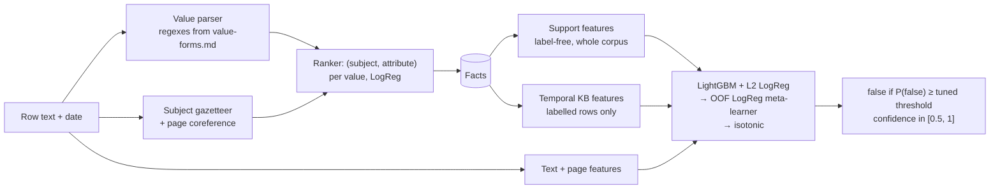

# Options A and B — classic core and truth discovery

> Owner: Arckan (P3). Run `python train/eval_truth_stack.py` (≈ 2.5 min) to reproduce every number here.
> It rewrites `train/results.csv` and saves `models/truth_stack.joblib`.

## What it does



| Step | File | Notes |
|---|---|---|
| Value parser | `app/extract/values.py` | Every kind except yes/no. Finds 2,226 of 2,228 gold values. `canonical()` makes equal values compare equal (14 days = 2 weeks). Counted nouns compare by number only. |
| Extractor | `app/extract/extractor.py` | Lexicon gazetteer (+ short forms such as "Hooly Cloud Next"), page coreference (up to 4 subjects from earlier rows / the headline), LogReg ranker over context-word × attribute features, separate yes/no scorer. |
| Features | `app/classify/truth_features.py` | Text/page flags · extraction stats · **support** (agrees with previous/next mention, value share, single-value pair, deviation from pair median) · **KB** (match latest / stale older / contradicts / future value, value seen only in false rows, ratio to latest value, op consistency). |
| Model | `app/classify/truth_model.py` | `TruthStack` (binary: false vs not-false), `TruthPipeline.label(rows)` for run time, `fit_pipeline(practice_rows, lexicon)`. |
| Eval | `train/eval_truth_stack.py` | Same 5 page folds for extraction and classification; time-forward split as in the SVM script. |

## Results (macro-F1 over true/false, README metric)

Latest run of `train/eval_truth_stack.py` (also in `train/results.csv`).
**Noise:** grouped CV moves by about ±0.5 points between seeds. Time-forward (one split, 82 false rows) moves by about **±3 points**, so read it as a rough check only.

| Model | Grouped page CV | Time-forward | Acc (grouped) | ECE (grouped) |
|---|---|---|---|---|
| 0: majority (all true) | 0.455 | 0.445 | 0.833 | — |
| SVM text-only + threshold | 0.562 | 0.498 | 0.722 | — |
| A: LightGBM | 0.724 | 0.666 | 0.872 | 0.010 |
| A: LogReg L2 | 0.722 | 0.722 | 0.865 | 0.008 |
| **A: LightGBM + LogReg stack (ships)** | **0.734** | 0.642 | **0.870** | 0.015 |
| B: stack + truth discovery | 0.740 | 0.707 | 0.872 | 0.011 |
| A stack on **gold** facts (upper bound) | 0.792 | — | — | — |
| A stack, 4-seed mean, labelled rows hand-labelled | 0.734 | 0.656 | — | — |
| A stack, 4-seed mean, all rows extracted (before) | 0.719 | 0.654 | — | — |

- **Extraction F1 0.836** out-of-fold (P 0.887, R 0.790), above MODELS.md's 0.80 bar, so the MiniLM fallback (option F) is not triggered.
- **Extraction is the bottleneck:** perfect facts would add about 7 points. The weakest kinds are names, percent and dates, mostly when the subject is only implied ("Referral share of hires: 33%").
- **Time-forward** sits a few points below grouped CV, but across seeds it ranges from 0.61 to 0.69 for the same setup, so it can't decide the MODELS.md ship gate (−2 points) on its own. B has been at or above A time-forward in every run so far (seed means 0.67 vs 0.65–0.67).
- **Speed:** labelling 19k synthetic rows took 77 s on a laptop (extraction + features + model). The runtime target is under 2 minutes for classifying.

## Extractor: classic vs wide

`FactExtractor(lexicon, wide=False)` (classic) is the default and what ships. `wide=True` adds:
- the company "Hooly" as an always-present subject candidate
- **page topics**: subjects whose attribute names match the page's words. Ties between quarters' results go to the quarter closest to the row's date.
- attribute-word candidates ("4 recruiters" → Hooly Hiring Programme `recruiters`)
- suffix and first-name short forms ("Plus", "Bertram"), and `Name:` speaker prefixes
- generic attribute-word overlap features in the ranker

| | Extraction P | R | F1 | Classifier (4-seed mean, grouped) |
|---|---|---|---|---|
| classic | 0.887 | 0.790 | 0.836 | **0.721** |
| wide | 0.883 | 0.853 | **0.868** | 0.708 (timeline from sentence-named facts) |
| wide without page topics | — | — | 0.858 | 0.700 |

**Finding:** wide reads more facts correctly, including more of the false values (137 vs 124 of 158), yet the classifier does about 1.3 points worse with it. The extra facts rely on subjects guessed from the page. Wrong guesses put wrong values into the KB timeline built from true rows, and correct values elsewhere then look like contradictions (true rows flagged false rose from 136 to 149).

Things tried that did not close the gap:
- dropping low-confidence facts
- building the timeline only from facts whose subject the sentence names (recovers about 1 point)
- extra relation features over those facts only (`rel_*_anchored`)

**Use wide where fact recall matters**, such as claim generation or a KB of current values. Keep classic for labelling. Each fact now carries `anchored` (subject named in its sentence), which downstream code can use to filter.

## Hand-labelled facts for labelled rows (shipped)

R-12 says the input has no `form` column, but the image may contain `data/practice.csv` with its forms, and the practice rows are the universe's labelled rows. Those rows only build the KB timeline and the corpus support; they are never judged. So the pipeline now uses their **hand-labelled** facts and extracts only the rows being judged.
- `fit_pipeline(..., use_gold=True)` (default) stores `gold_by_id`: practice id → (text, facts).
- At run time, a labelled row uses those facts only when its id **and** text match a practice row; otherwise it is extracted as before.
- Training mirrors run time: in every inner fold, judged rows are extracted and labelled rows are hand-labelled (`mixed_training_table`).

| Facts for labelled rows (4 seeds) | Grouped CV, stack | Time-forward, stack | LogReg alone, grouped / time |
|---|---|---|---|
| Extracted (before) | 0.719 (0.716–0.722) | 0.654 | 0.701 / 0.695 |
| **Hand-labelled (now)** | **0.734** (0.724–0.744) | 0.656 | **0.726 / 0.719** |

All four hand-labelled seeds beat all four extracted ones (+1.6 points grouped). Time-forward is level for the stack.
Why it works: wrong extractions in labelled rows were putting wrong values into the timeline, which made correct values elsewhere look like contradictions (the same problem that sank the wide extractor). A clean timeline removes that noise; only the judged row's own extraction can still be wrong.
**Assumption:** the real universe keeps the practice rows' ids and texts, as `scripts/check.sh` does. If it does not, nothing breaks: those rows fall back to extracted facts.

## Honesty rules (no leaks)
- Facts for every practice row come from an extractor that never saw that row's page.
- KB features for test rows use training labels only. Training rows get theirs out-of-fold (inner GroupKFold), never from their own page.
- Calibration and the P(false) threshold (≈ 0.24–0.30) are tuned on training rows only.
- Support features use no counts, because the universe is ~10× the practice set. They use shares and flags only.

## Run-time use (for P2)
```python
import joblib
pipe = joblib.load("models/truth_stack.joblib")
labels = pipe.label(universe_rows)  # rows: id, text, date, label ("" if unknown), in file order
# -> [{"id", "label": "true"|"false", "confidence": 0.5..1.0}] for the unlabelled rows
```
Labelled rows in the universe feed the KB automatically. Dependencies: `numpy pandas scikit-learn lightgbm joblib`.

## Not done yet
- `unsure` is never predicted (39 practice rows; R-21 allows it, the README metric ignores it).
- Name values are only recognised if they are in the lexicon or appeared in the training forms.

# Option B — truth discovery (built, ablated, not shipped)

`app/classify/truth_discovery.py` runs an unsupervised EM loop (TruthFinder / Dawid-Skene style). **Sources** are pages, **claims** are extracted facts.
- **Value belief:** how strongly other pages' mentions of the same (subject, attribute) back this value. Each mention is weighted by its page's reliability and by time closeness, `exp(-|days| / tau)`.
- **Page reliability:** the smoothed mean belief of the page's facts.

The two are updated in turn until they converge. It uses no labels, so it is fold-safe and runs on the whole universe.

Row features: `td_belief_min/mean/max`, `td_page_reliability` (plus a leave-this-row-out version), `td_belief_vs_page`.
Switch: `label_free_features(..., truth_discovery=True)` / `fit_pipeline(..., truth_discovery=True)`.

| Check | Result |
|---|---|
| `td_belief_min` alone, AUC for false rows | **0.81** (`tau` 30 d). The best existing label-free feature is 0.69 |
| Page reliability alone, AUC | 0.55 to 0.62: weak |
| Stack + TD, grouped CV, 4 seeds | mean 0.719 vs 0.722 without it: no gain |
| `tau` sweep (10 / 20 / 30 / 60 d, and combinations) | −0.8 to +0.3 points grouped. Only 60 d is not negative |
| Page trust from the classifier's own predictions (average P(false) of other rows on the page) | AUC 0.55, +0.3 points: noise |

**Why no gain:** the belief score is strong alone, but the support features (agrees with previous/next mention, value share near the date) already carry the same information. Page reliability is weak because most practice pages have only a few facts, and the 19 "lying" pages are not predictable from their other rows.

**Ship rule:** the eval script runs A and B every time and ships B only if it wins by at least 1 point on grouped CV and is no worse time-forward. The latest run gave B +0.8 grouped and +0.4 time-forward, so A ships.
**Open question:** the real universe has about 10× more rows per (subject, attribute), so beliefs and page reliability will be estimated from far more neighbours there. B may help at run time even though the practice set can't show it. Turn it on if a larger labelled check becomes available.

# Option D — liquid net over fact timelines (built, measured, not shipped)

`app/classify/timeline_net.py` turns each extracted fact into a sequence: the other pages' mentions of the same (subject, attribute), up to 24, nearest in time first and then put in date order. Each step says:
- how far away in time the mention is
- whether it states the same value
- whether its row is a known true or false row (training labels only, never its own page)
- how its number compares

A **CfC** (closed-form continuous-time net, `ncps`) reads the sequence, with its state evolving over the real time gap between mentions. A **GRU** runs as the control. The net's P(false) becomes a third base model in `TruthStack`, fitted inside the same out-of-fold loop. Switch: `TruthStack(seq_kind="cfc"|"gru")`, `fit_pipeline(..., seq_kind=...)`, `python train/eval_truth_stack.py D D-GRU`.

Note: `ncps.CfC` squeezes per-sample time gaps to the wrong shape, so the code steps a `CfCCell` by hand.

| Model (2-seed mean) | Grouped CV | Time-forward | Run time (grouped) |
|---|---|---|---|
| A: stack | **0.718** | **0.674** | 2.5 min |
| D: stack + CfC | 0.709 | 0.672 | 10.4 min |
| D-GRU: stack + GRU (control) | 0.720 | 0.645 | 6 min |
| CfC alone | 0.600 | 0.619 | — |
| GRU alone | 0.680 | 0.527 | — |

**Findings**
- **Neither sequence net helps the stack.** CfC is −0.9 points grouped and GRU is +0.2, both within noise. GRU is −2.9 points time-forward.
- **The GRU beats the CfC** on its own (0.68 vs 0.60 grouped; held-out fact AUC 0.73–0.77 vs 0.69–0.70). The CfC also turns unstable with higher learning rates or longer training.
- **Why no gain:** the timeline features (match latest, stale, contradicts, days since change) already state what the nets have to learn from about 2,000 labelled facts.
- **Cost:** torch adds about 250 MB to the image, and CfC training is about 4× slower. Not worth it while it doesn't win.

**For the pitch:** "we tried a liquid time-constant network on irregular fact timelines; a plain GRU beat it and neither beat explicit temporal features" is an honest, defensible result.
